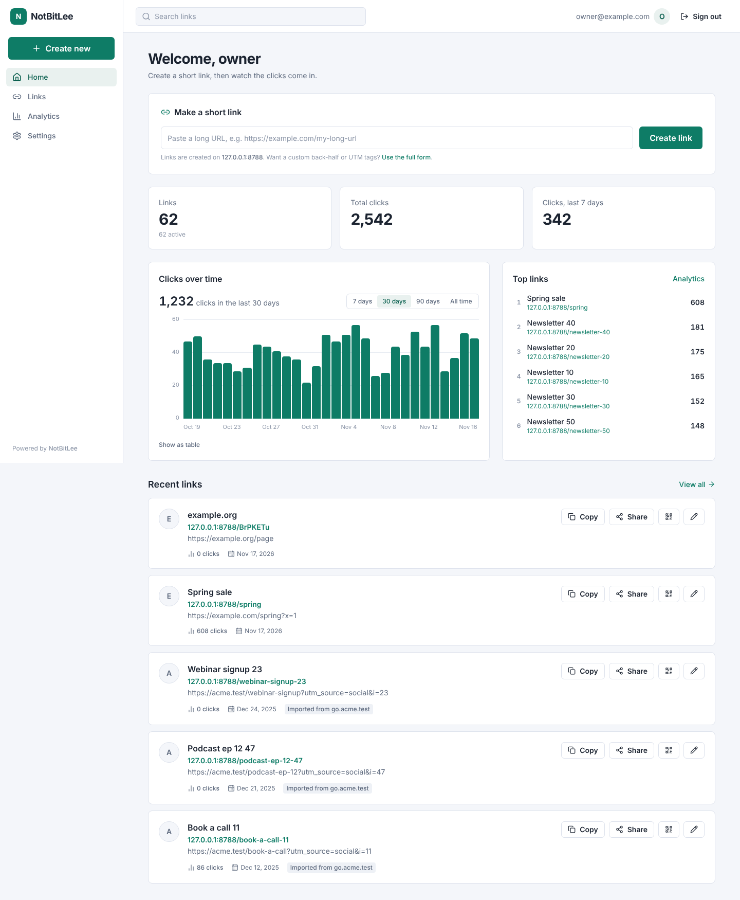
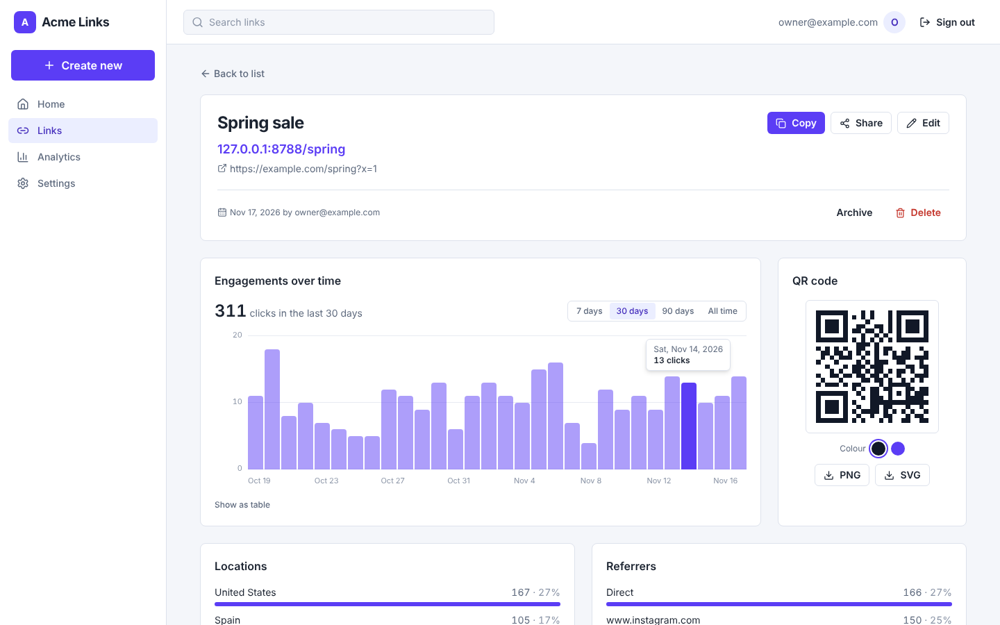

# NotBitLee

**[notbitlee.com](https://notbitlee.com)** · An open-source, white-label link shortener with click analytics, QR codes and team logins. It deploys to **your own Cloudflare account** in one click: no server, no hosting bill, no per-seat pricing.

[](LICENSE)
[](https://github.com/zimamedia/notbitlee/actions/workflows/ci.yml)
[](https://workers.cloudflare.com)

[](https://deploy.workers.cloudflare.com/?url=https://github.com/zimamedia/notbitlee)



- **Short links on your own domain**, with custom back-halves and a UTM builder
- **Click analytics**: clicks per day, countries and referrers for every link and for the whole account
- **QR codes** for every link, downloadable as PNG or SVG
- **White-label branding**: your name, logo and colour on the dashboard, sign-in page and 404 page
- **Team sign-in** with email and password, plus optional Google sign-in. Owners and members. No seat fees.
- **Import from Bitly**: upload your Bitly CSV export and keep every back-half
- **Your data stays in your Cloudflare account**, in a D1 database only you can reach

## Deploy in one click

1. Click **Deploy to Cloudflare** above and sign in to Cloudflare (a free account is enough).
2. Cloudflare copies this repository to your GitHub account and creates a database for you.
3. When asked, fill in:
   - `ADMIN_EMAIL`: the email you will sign in with
   - `ADMIN_PASSWORD`: your password, at least 10 characters
   - `BRAND_NAME`, and optionally `TIMEZONE`, e.g. `Europe/Madrid`
4. Click **Deploy**. When it finishes, open `https://notbitlee.<your-subdomain>.workers.dev/admin` and sign in.

That's it. Short links work straight away on the `workers.dev` address. Create one from the dashboard, then open it in a private window.

### Use your own domain

1. Add the domain to your Cloudflare account, if it isn't there yet.
2. In the Cloudflare dashboard, open the **notbitlee** Worker → **Settings → Domains & Routes → Add → Custom domain**, and enter e.g. `go.example.com`.
3. In **Settings → Variables and Secrets**, set `SHORT_DOMAIN` to `go.example.com` so links are shown and copied with it.

The dashboard is always at `/admin` on the same domain. To give it a separate domain, such as `links.example.com`, add that domain to the Worker too and set `DASHBOARD_DOMAIN`. On that domain, every path then opens the dashboard instead of a short link.

### Brand it

Sign in, open **Settings → Branding**, and set your name, colour, logo URL and the page your bare domain should send people to. You can also turn off the “Powered by NotBitLee” line.



### Move from Bitly

In Bitly, open **Links**, select all and choose **Export**. Then upload the CSV in **Settings → Import from Bitly**. Every link keeps its back-half, title and destination. Back-halves you already have here are skipped, so importing twice is safe.

Links on your own Bitly custom domain keep working once that domain points at this Worker. Plain `bit.ly` links are copied to the same back-half on your domain, but the old `bit.ly` addresses stop working if you close your Bitly account.

For very large exports, use the command line instead:

```bash
npm run import:bitly -- path/to/export.csv --remote
```

## Settings

| Name | Kind | What it does |
| --- | --- | --- |
| `ADMIN_EMAIL` | Secret | The owner account's email. Always able to sign in. |
| `ADMIN_PASSWORD` | Secret | The owner account's password. Change it here to reset it. |
| `BRAND_NAME` | Variable | Starting brand name. Settings → Branding overrides it. |
| `SHORT_DOMAIN` | Variable | Domain short links are shown with, e.g. `go.example.com`. Empty uses the current domain. |
| `DASHBOARD_DOMAIN` | Variable | Optional separate dashboard domain. |
| `TIMEZONE` | Variable | Time zone for daily click charts. Defaults to `UTC`. |
| `ALLOWED_EMAIL_DOMAIN` | Variable | With Google sign-in, lets everyone at this Workspace domain in. |
| `GOOGLE_CLIENT_ID`, `GOOGLE_CLIENT_SECRET` | Secrets | Optional. Turn on “Continue with Google”. |
| `SESSION_SECRET` | Secret | Optional. Signs sign-in cookies. If unset, a random key is created and kept in the database. |

Change any of them in the Cloudflare dashboard under the Worker's **Settings → Variables and Secrets**. Secrets are encrypted and never shown again.

### Teammates

Owners can add people in **Settings → Team**, either with a temporary password or, if Google sign-in is on, with no password. Members can create and edit links. Owners can also change branding and the team. Removing someone signs them out at once.

### Google sign-in (optional)

1. In Google Cloud Console, create an OAuth client of type **Web application**.
2. Add `https://<your-dashboard-domain>/api/auth/callback` as an authorised redirect URI.
3. Add `GOOGLE_CLIENT_ID` and `GOOGLE_CLIENT_SECRET` as secrets on the Worker.

People can then use Google if they are on the team, or if their verified Google Workspace account is on `ALLOWED_EMAIL_DOMAIN`.

## Updating

The deploy button made a copy of NotBitLee in your GitHub account, connected to your Worker. To get new features and security fixes, pull from this repository into your copy. Cloudflare then redeploys it automatically and applies any database changes.

```bash
git clone https://github.com/<you>/notbitlee.git && cd notbitlee
git remote add upstream https://github.com/zimamedia/notbitlee.git
git pull upstream main
git push
```

Your links, clicks, team and branding live in your database, not in the code, so updating never touches them. See the [changelog](CHANGELOG.md) for what's new.

## Costs and limits

NotBitLee runs on Cloudflare Workers and D1. Every redirect is one Worker request and one database write, the click record. Cloudflare's free plan has daily limits on both, which is plenty for most small teams and agencies. For heavy traffic, Cloudflare's paid Workers plan raises those limits. Check Cloudflare's pricing pages for current numbers.

## Run it locally

```bash
npm install
cp .dev.vars.example .dev.vars   # then edit the email and password
npm run db:migrate:local
npm run dev
```

Open `http://127.0.0.1:8788/admin`. Short links work at `http://127.0.0.1:8788/<back-half>`. If `.dev.vars` has no sign-in set up, you are signed in automatically as a local preview owner.

```bash
npm test            # unit tests
npm run typecheck
npm run lint
npm run deploy      # build, apply migrations and deploy with your own Wrangler login
```

### Manual deploy without the button

```bash
npx wrangler d1 create notbitlee        # paste the database_id into wrangler.jsonc
npx wrangler secret put ADMIN_EMAIL
npx wrangler secret put ADMIN_PASSWORD
npm run deploy
```

## How it works

- `worker/`: the Cloudflare Worker. It serves redirects, the JSON API under `/api`, and the dashboard under `/admin`.
- `src/`: the React dashboard.
- `shared/`: code used by both, such as slug rules, the Bitly CSV parser and click summaries.
- `migrations/`: the D1 schema. It is applied automatically on every deploy.
- `site/`: the [notbitlee.com](https://notbitlee.com) landing page. It isn't part of the app and doesn't deploy with it.

Back-halves `admin`, `api` and `assets` are reserved for the app.

## Contributing

Bug reports, ideas and pull requests are welcome. Start with [CONTRIBUTING.md](CONTRIBUTING.md), and please follow the [code of conduct](CODE_OF_CONDUCT.md). Found a security problem? Report it privately as described in [SECURITY.md](SECURITY.md).

## Licence

[MIT](LICENSE). Use it, change it, deploy it for clients and brand it as your own. Just keep the licence file.

---

Made by [Zima Media](https://zimamedia.com): martech, ad tech and SaaS development.
